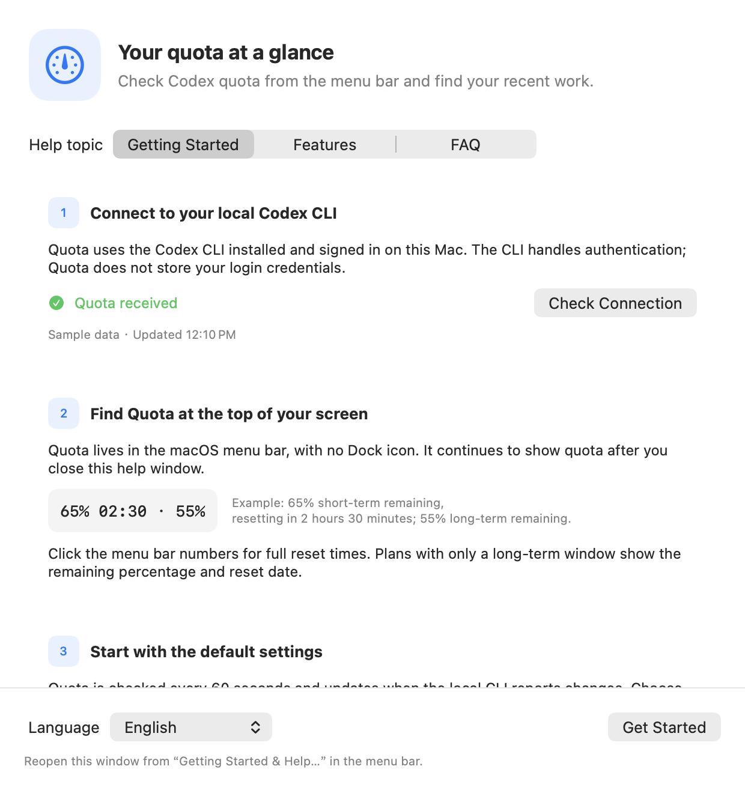
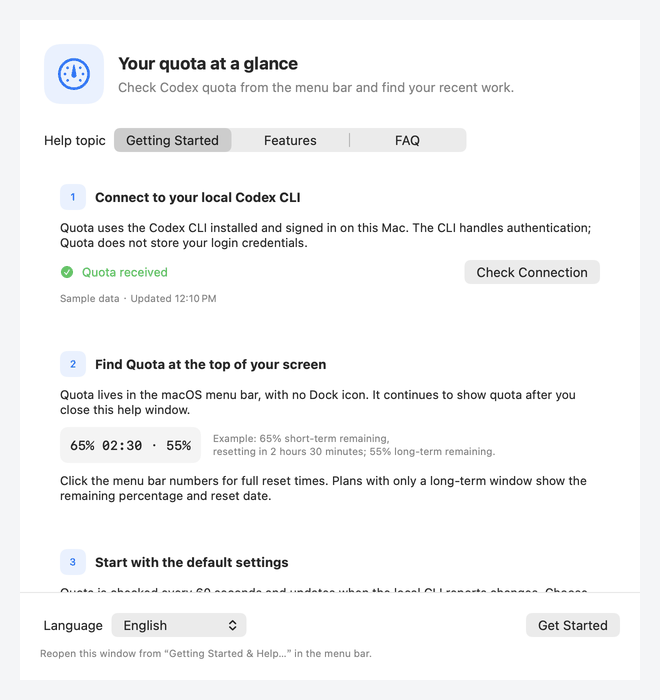

# Codex Quota Menu Bar

**English** | [简体中文](README.zh-CN.md)

Configuration and secondary commands live in **Settings...** (Cmd+,). The menu shows quota and reset information, freshness, available Codex Reset reports, and a direct **Find Codex sessions…** command. In **General**, long-term / weekly reset reminders are on by default: red below 24 hours, orange from 24 to below 72 hours. Configure the switch and thresholds there. These colors use the account long-term quota deadline, independently of short-term windows and third-party reports. Passed deadlines remain "Awaiting a confirmed new cycle" until new quota data confirms a later reset. **Automation & Notifications** holds scheduled requests, execution diagnostics, and Codex Reset notifications; **Tools & Help** holds sessions, help, updates, and Quit.

A native menu bar app for macOS 13+ that shows your remaining Codex quota and reset times. It has no Dock icon or persistent main window. Click its menu bar item for details.

This is an unofficial community project and is not affiliated with OpenAI.

**Languages:** the app and documentation support English and Simplified Chinese. The app uses the first supported language in your system language preferences by default, falling back to English. Choose **Settings → General → Language → Follow System / 简体中文 / English**, or use the language picker in Help, to switch immediately; your choice is saved. Your session titles, task text, project paths, and messages from external services stay in their original language.

## Screenshots and short tour



[中文界面](docs/images/help-zh.png) · [About & Updates](docs/images/about-en.png)



Native app views rendered with synthetic data. The short tour cycles through English and Chinese help and version information; it contains no account or session data.

## Requirements

- macOS 13 or later.
- Codex CLI installed and signed in on the same Mac.
- Xcode or compatible Command Line Tools to build from source. Full Xcode runs the complete XCTest suite; CLT runs the focused offline checks. XcodeGen is only needed to regenerate the included project.

## Download and install

Download the universal DMG from [GitHub Releases](https://github.com/xixiba-ai/codex-quota-menubar/releases). It includes Apple Silicon and Intel builds. Open the disk image and drag **Codex Quota.app** into **Applications**.

**Version 1.0.0** ships as a universal macOS app. **It uses an ad-hoc signature, has no Apple Developer ID signature, and has not been notarized by Apple.** macOS may block the first launch. See the [installation guide](docs/INSTALL.en.md) for system prompts and SHA-256 verification. The build targets macOS 13+; Intel and every supported OS/hardware combination have not been runtime-tested.

See the [maintenance guide](docs/HANDOFF.en.md) for project structure, local deployment, and maintenance checks. Run `./scripts/verify.sh` for routine verification.

## Getting started and help

A help window appears automatically on first launch. After that, open it from **Settings → Tools & Help → Getting Started & Help…**.

- **快速上手** (Getting started): connection status and retry, a menu bar example, and default settings.
- **功能说明** (Features): quota reads versus scheduled requests, session search and cleanup.
- **常见问题** (FAQ): CLI connectivity, quota display, scheduled activity, session lookup, and reopening help.

**检查连接** (Check connection) refreshes the displayed quota without starting a conversation task. Scheduled **自动刷新额度** sends real Codex requests, may consume a small amount of quota, and does not guarantee a quota reset.

## Build from source

The project uses XcodeGen for its project definition. If you have XcodeGen installed, run `xcodegen generate` before opening `CodexQuotaMenuBar.xcodeproj`. You can also use the included project directly:

```sh
./scripts/verify.sh

# Build the release configuration
xcodebuild -project CodexQuotaMenuBar.xcodeproj -scheme CodexQuotaMenuBar -configuration Release build

# Package committed source as a universal DMG (requires a clean working tree)
./scripts/package-release.sh 1.0.0 7
```

Packaging automatically uses full Xcode when available, otherwise `scripts/build-clt.py` builds arm64 and x86_64 with CLT. The CLT path generates the app icon directly from committed PNGs and copies named status PNGs; it never reuses an installed app or an asset catalog. It records the source commit, build method, and a resource SHA-256 manifest. Set `CODEX_QUOTA_BUILD_SYSTEM=clt` to force that path and `CODEX_QUOTA_CLT_SDK` to select a compatible SDK. The installed macOS 26.5 SDK is preferred because the CLT 27.x SwiftUI SDK needs macro plugins included only with full Xcode. `verify.sh` runs the full XCTest suite with Xcode, or the same-source reminder and Codex Reset CLI checks with CLT.

## Data sources and sessions

By default, the app connects to your locally authenticated Codex CLI through `codex app-server --stdio`, reads quota, and updates the menu bar when quota changes. The app does not read or store Codex/ChatGPT login credentials; the CLI handles authentication.

**Settings → Tools & Help → Find Codex sessions…** lists locally saved CLI and VS Code sessions. Search by title, initial task, project directory, or session ID, and filter by project or the last seven days. Select a session and choose **Resume in Terminal** to open macOS Terminal, enter the project folder, and run `codex resume` for that session. **Copy Resume Command** remains available as a fallback, and you can still open the project in Finder. Listing or selecting sessions does not resume, interrupt, or modify them; resuming starts only when you click the action.

The session panel also supports **终止并删除会话** (Stop and delete session) and bulk deletion by last activity, defaulting to sessions older than seven days. **Deletion permanently removes the session and its derived sessions and cannot be undone.** Bulk cleanup skips active sessions and asks for confirmation with the affected count.

The local app-server protocol is experimental. Codex CLI updates may require changes to this app. If your CLI is installed outside the default locations, configure its path:

```sh
defaults write com.example.CodexQuotaMenuBar codexExecutablePath "$HOME/.local/bin/codex"
```

To use your own authorized HTTPS quota service, set `usageEndpoint`. A configured endpoint takes precedence over the local CLI:

```sh
defaults write com.example.CodexQuotaMenuBar usageEndpoint 'https://your-authorized-service.example/usage'
defaults write com.example.CodexQuotaMenuBar usageEndpointBearerToken 'YOUR_TOKEN'
```

The endpoint must return JSON with ISO-8601 dates:

```json
{
  "shortTerm": { "remainingPercent": 65, "resetsAt": "2026-07-10T17:56:00Z" },
  "longTerm": { "remainingPercent": 55, "resetsAt": "2026-07-13T00:00:00Z" },
  "updatedAt": "2026-07-10T09:00:00Z",
  "sourceDescription": "Codex"
}
```

Remove `usageEndpoint` to return to the local CLI data source. The app checks quota every 60 seconds and also reacts to CLI quota updates. **立即刷新** (Refresh now) performs a manual check. The menu shows progress, the success time, or the failure reason; timed-out CLI requests can be retried.

A failed read retains the previous values but marks them **stale** inside the menu. Data older than three minutes is also marked stale. The menu shows the data age; the source tooltip gives the full update date without an exclamation warning in the menu bar; successful reads or live updates restore the current status. Opening the menu refreshes these labels.

When supplied by the service, the menu shows the remaining earned usage-limit resets and their next expiration, updated with quota reads. The service supplies the authoritative count. Partial details show the earliest known expiration; missing details are labeled explicitly. Expiration dates are never inferred.


## Codex Reset notifications

**Settings → Automation & Notifications → Codex Reset notifications** reads the public `https://codex-reset.com/api/timeline` endpoint. Data: [codex-reset.com](https://codex-reset.com/timeline), a third-party source. No X sign-in, cookies, Codex credentials, or user quota data are sent. Requests run at most once per minute, respecting cache freshness and `Retry-After`. Disabled monitoring makes no requests. Existing notification permission is reused; a separate button requests permission only if it has not yet been decided.

Only `group=reset` with `announcement_state=announced` is labeled a reported global reset. Available banked reset credits have a separate label. Teasers, probabilities, and missing confirmation states do not confirm resets. These reports do not prove a grant to your account and never change local quota deadlines or automatic-use rules.

The old monitor's enabled preference migrates once; old X caches and cursors do not. The first fresh, nonempty timeline establishes a silent baseline. Later confirmed events and confirmation transitions are deduplicated across launches; old backfills do not generate historical notification bursts. Delivery is best effort and failures are shown. Cached events retain their original dates and links; failed or stale reads retain the cache and expose the last success time. Stop cancels active reads. Safe source links open the timeline or known original X posts.

## Scheduled Codex requests

**Settings → Automation & Notifications → 自动刷新额度** toggles scheduled activity. The feature is off by default. For accounts with a short-term quota, its default schedule sends a minimal local Codex CLI request at **05:30, 10:30, 15:30, and 20:30**, using local time. This runs independently from the quota reader and does not change its 60-second refresh interval.

Choose **修改触发时间…** (Edit Trigger Times) to enter one or more `HH:mm` 24-hour times, separated by English commas: `06:00, 12:30, 18:00`. Both languages use the same format; Chinese commas, enumeration commas, and empty entries are rejected. Existing saved schedules are preserved. Saving immediately reschedules the next trigger.

While enabled, the app also sends one minimal request when a successful quota read detects recovery after a manual or service reset. CLI notifications or the next 60-second read detect recovery. The first read, account changes, and small rolling-window changes do not trigger requests. All reported windows must be usable, and an explicit backend denial prevents use. Requests are deduplicated against scheduled requests or retries covering the same recovery; the result shows “Use after quota recovery”. Disabling the feature stops future recovery triggers. For accounts with only a weekly (or other single long-term) quota, Settings explains automatic use after reset. Daily time settings remain editable but inactive, with the saved times reused if short-term quota returns; the next daily trigger is hidden. Daily requests and launch/wake compensation are suspended; saved daily times are preserved and return when a short-term quota is detected. The toggle still controls automatic use. For these accounts, two successful reads crossing its reported reset time also trigger one request even if the remaining percentage is unchanged; quota must still be usable and the backend must not explicitly deny use.

**Settings → Automation & Notifications** shows the current state, last trigger, result (in progress, succeeded, or failed), trigger reason, and next scheduled trigger. Failures show a safe category such as CLI unavailable, timeout, or exhausted quota; any pending quota-reset retry has its own time. An interrupted request is marked as failed after relaunch, rather than left in progress. The app persists its setting, latest result, and handled time windows. On launch or wake after a missed schedule, it compensates for only the most recent missed window and does not repeat a handled window.

Scheduling checks, trigger reasons, results, and errors go to macOS Unified Logging under subsystem `com.example.CodexQuotaMenuBar`, category `AutoRefresh`. Error details are marked private.

## Version and updates

Open **About & Updates…** from **Settings → Tools & Help** to see the installed release version, MIT license, and GitHub releases link. **Check for Updates** reads the public GitHub release list only when clicked, without Codex credentials or session data. Stable builds check stable releases. New versions open their release page for manual download. This does not install updates automatically.

## License

[MIT License](LICENSE). The source and installer include the license.
