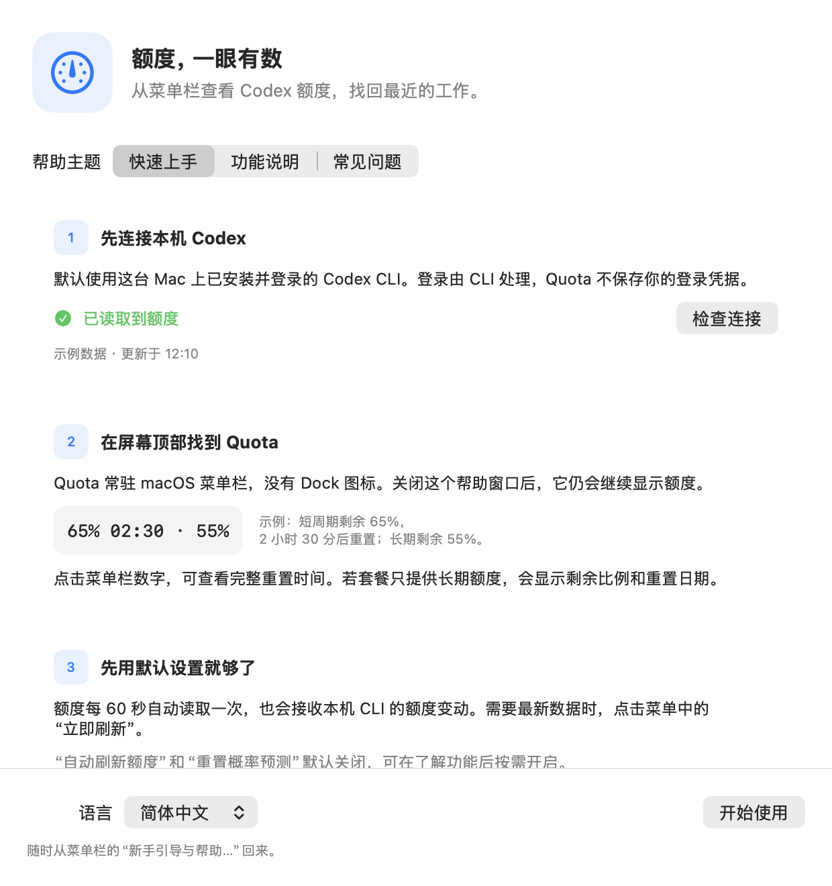
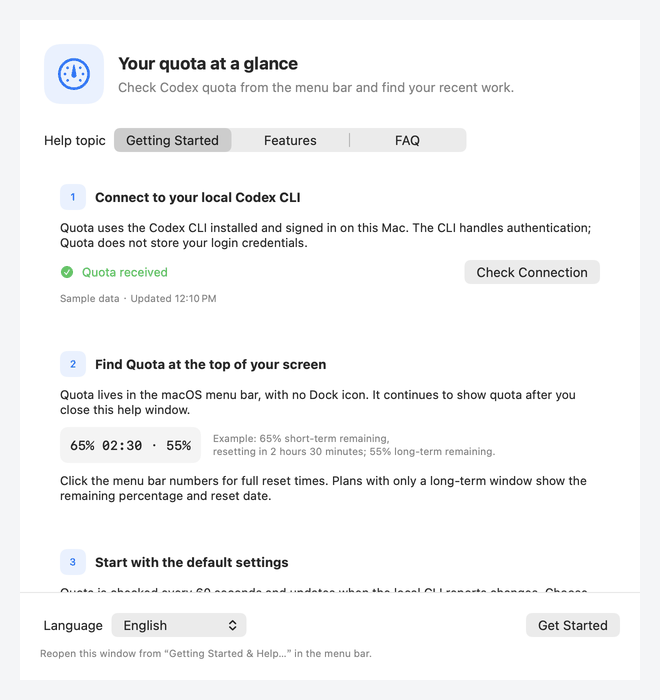

# Codex Quota Menu Bar

[English](README.md) | **简体中文**

配置与次要操作统一放在 **设置…**（Cmd+,）：展开菜单显示额度、重置时间、新鲜度、已有 Codex Reset 报告，并保留重要的 **定位 Codex 会话…** 直接入口。在 **通用** 中，长期／周额度重置颜色提醒默认开启：剩余小于 24 小时为红色，24 小时起且小于 72 小时为橙色；可关闭或修改阈值。短周期与第三方动态不参与提醒。到期后显示“等待新周期确认”，直到读取到新的长期重置时间。**自动使用与通知** 包含自动刷新计划、执行诊断和 Codex Reset 通知，**工具与帮助** 包含会话、帮助、更新和退出。

一个 macOS 13+ 的原生 SwiftUI 菜单栏工具。它没有 Dock 图标和常驻主窗口；菜单栏显示剩余额度和重置倒计时，点击可查看详情。

这是社区维护的非官方项目，与 OpenAI 无隶属关系。

**语言支持**：应用和文档均支持简体中文与英文。应用默认按系统首选语言顺序选择支持的语言，没有匹配时回退为英文。**设置 → 通用 → 语言 → 跟随系统 / 简体中文 / English** 可立即切换并保存偏好，帮助窗口也提供语言选择入口。会话标题、任务内容、项目路径和外部服务返回的信息保持原文。

## 界面与简短演示



[English interface](docs/images/help-en.png) · [关于与更新](docs/images/about-zh.png)



以上为使用虚构数据渲染的原生应用界面。简短演示轮播中英文帮助和版本信息，不包含真实账户或会话内容。

## 使用前准备

- macOS 13 或更新版本。
- 已安装并登录的 Codex CLI，用于读取本机账号额度。
- 从源码构建可使用 Xcode 或兼容的 Command Line Tools。完整 Xcode 可运行全部 XCTest；CLT 可运行离线专项检查。仓库已包含 Xcode 工程，XcodeGen 仅在重新生成工程时需要。

## 下载安装

从 [GitHub Releases](https://github.com/xixiba-ai/codex-quota-menubar/releases) 下载通用 DMG，支持 Apple Silicon 和 Intel Mac。打开磁盘映像后，将 **Codex Quota.app** 拖入 **Applications** 文件夹。

**1.0.0 正式版**提供 macOS 通用安装包。**使用 ad-hoc 完整性签名，没有 Apple Developer ID 签名、未经过 Apple 公证**，首次打开可能被 macOS 拦截。系统提示及 SHA-256 校验方法见 [安装说明](docs/INSTALL.md)。构建目标为 macOS 13+；Intel 及所有受支持系统、硬件组合尚未逐一运行验证。

项目结构、启动方式、部署注意事项和维护清单见 [交接文档](docs/HANDOFF.md)。日常验证可直接执行 `./scripts/verify.sh`。

## 新手引导与帮助

首次启动会自动显示帮助窗口，关闭后不再自动弹出；可随时从“设置 → 工具与帮助 → 新手引导与帮助…”重新打开。

- **快速上手**：连接状态与重试、菜单栏数值示例、默认设置说明。
- **功能说明**：额度读取与计划请求的区别、第三方重置概率、会话搜索与清理，可直接打开会话列表。
- **常见问题**：CLI 连接、额度显示、自动刷新、会话查找与帮助入口。

帮助窗口中的“检查连接”只刷新额度数据。计划执行的“自动刷新额度”会发起实际 Codex 请求，可能消耗少量额度，不保证重置额度。

## 构建

该项目使用 XcodeGen 描述工程。若已安装 XcodeGen，执行 `xcodegen generate` 后在 Xcode 中打开 `CodexQuotaMenuBar.xcodeproj`，或执行：

```sh
./scripts/verify.sh

# 生成发布构建
xcodebuild -project CodexQuotaMenuBar.xcodeproj -scheme CodexQuotaMenuBar -configuration Release build

# 从已提交源码打包通用 DMG（工作区必须干净）
./scripts/package-release.sh 1.0.0 7
```

打包默认优先使用完整 Xcode；没有 Xcode 时由 `scripts/build-clt.py` 使用 CLT 分别构建 arm64、x86_64，再合并为通用应用。CLT 路径直接从已提交 PNG 生成应用图标并复制命名状态图，不复用已安装应用或资产目录，记录源码提交、构建方式和资源 SHA-256 清单。可通过 `CODEX_QUOTA_BUILD_SYSTEM=clt` 强制选择 CLT，通过 `CODEX_QUOTA_CLT_SDK` 选择兼容 SDK。优先使用已安装的 macOS 26.5 SDK，因为 CLT 27.x 的 SwiftUI SDK 需要完整 Xcode 才提供的宏插件。`verify.sh` 在 Xcode 下运行全部 XCTest，在 CLT 下运行同源的提醒及 Codex Reset 专项检查。

## 数据源

默认直接连接本机已登录的 Codex CLI（`codex app-server --stdio`），读取当前额度并在额度变化时更新菜单栏。它不会读取或保存 Codex/ChatGPT 登录凭证；认证仍由 Codex CLI 自身处理。

“设置 → 工具与帮助 → 定位 Codex 会话…”会读取本机已保存的 CLI 和 VS Code 会话。可按标题、首条任务、项目目录或 Session ID 搜索，并可筛选项目与最近 7 天；选中会话后，点击 **在终端续接**，即可打开 macOS“终端”、进入项目目录并运行该会话的 `codex resume`。仍保留 **复制续接命令** 作为备用入口，也可在 Finder 打开项目目录。读取列表或选中会话不会恢复、中断或修改会话；只有点击续接按钮才会启动。

会话面板还支持单条“终止并删除会话”，以及按最后活跃时间批量删除会话（默认 7 天前）。删除会永久移除会话记录及其派生会话，不能恢复；批量删除会自动跳过仍在运行的会话，并在操作前显示影响数量并要求确认。

该本地 app-server 协议目前标为 experimental；Codex CLI 更新后，应用可能需要随之适配。若本机 CLI 不在默认位置，可配置路径：

```sh
defaults write com.example.CodexQuotaMenuBar codexExecutablePath "$HOME/.local/bin/codex"
```

如需改用你自己的 HTTPS 额度服务，配置 `usageEndpoint` 后会优先使用远程数据源：

配置键：

```sh
defaults write com.example.CodexQuotaMenuBar usageEndpoint 'https://your-authorized-service.example/usage'
defaults write com.example.CodexQuotaMenuBar usageEndpointBearerToken 'YOUR_TOKEN'
```

端点需要返回 ISO-8601 日期：

```json
{
  "shortTerm": { "remainingPercent": 65, "resetsAt": "2026-07-10T17:56:00Z" },
  "longTerm": { "remainingPercent": 55, "resetsAt": "2026-07-13T00:00:00Z" },
  "updatedAt": "2026-07-10T09:00:00Z",
  "sourceDescription": "Codex"
}
```

移除 `usageEndpoint` 会恢复本地 Codex CLI 数据源。应用仍每 60 秒主动校验一次，也会在本地 CLI 推送额度变动时立即更新；点击“立即刷新”可手动读取。菜单会显示读取状态、成功时间或失败原因；CLI 请求超时后可以重试。

数据源提供时，菜单显示可主动使用的“使用限额重置”剩余次数和最近到期时间，随额度读取更新。次数以服务返回为准；明细不完整时显示“已知最近到期”，未提供明细时明确标注，不推算到期时间。

## Codex Reset 动态通知

在 **设置 → 自动使用与通知 → Codex Reset 动态通知** 读取公开的 `https://codex-reset.com/api/timeline`。数据来源：[codex-reset.com](https://codex-reset.com/timeline)，属于第三方报告。无需 X 登录，不发送 Cookie、Codex 凭据或用户额度。最多每分钟请求一次，遵守缓存有效期及 `Retry-After`；关闭后不请求数据。复用已有系统通知权限，只有你点击授权按钮且系统尚未决定权限时才请求授权。

仅 `group=reset` 且 `announcement_state=announced` 标为报告的全局重置；可用的存储重置券单独标记。预告、概率和缺失确认状态都不视为确认重置。第三方报告不代表你的账号已到账，不会修改长期额度时间或自动使用规则。

旧监测开关仅迁移一次，不继承旧 X 缓存或去重游标。首次新鲜、非空的时间线只建立基线，不通知历史事件；后续新确认及状态变更跨重启去重，旧回填不触发历史通知风暴。通知为尽力发送，失败会明确显示。缓存事件保留原日期与安全来源链接；更新失败或数据过期时保留缓存并展示上次成功时间，停止会取消正在执行的读取。

## 自动刷新额度

“设置 → 自动使用与通知”中的“自动刷新额度”可直接开启或关闭此功能，默认关闭。对于含短周期额度的账号，开启后默认按本地时间每天 05:30, 10:30, 15:30, 20:30 发起一次最小化的本机 Codex CLI 请求；它与原有的额度读取进程相互独立，不会改变额度读取的 60 秒刷新频率。点击“修改触发时间…”可按 `HH:mm` 的 24 小时制设置一个或多个时间，统一使用英文逗号分隔，例如 `06:00, 12:30, 18:00`。中英文界面使用同一格式，不接受中文逗号、顿号或空白项；已保存的计划不受影响。保存后会立即重新安排下一次触发。

“设置 → 自动使用与通知”同时显示当前状态、最近一次触发时间及下一次计划触发时间。应用会保存开关、最近结果和已处理的时间窗口；如果电脑休眠或关机后错过计划点，重新启动或唤醒时只对当前最新的遗漏窗口补偿一次，不会重复执行同一窗口。

调度检查、触发原因、结果和错误会写入 macOS Unified Logging（子系统为 `com.example.CodexQuotaMenuBar`，分类为 `AutoRefresh`），可在“控制台”中查看。

## 许可证

采用 [MIT License](LICENSE)。源码和安装包均附带许可证。

## 数据是否新鲜

读取失败时保留上次额度，并在菜单内标记“已过期”；超过 3 分钟的数据也会标记过期。菜单显示数据年龄，数据源提示中提供完整更新时间，菜单栏不显示叹号提醒。成功读取或收到实时更新后恢复“最新”状态，打开菜单时会更新这些提示。

开启时，还会在成功读取到主动或官方重置后的额度恢复时使用一次最小请求。恢复通过 CLI 推送或下一次 60 秒读取发现；首次读取、切换账号以及小幅滚动额度变化不会触发。多个额度周期需都可用，服务明确禁止使用时不会触发。恢复请求会与同一次重置后的计划请求或重试去重，执行原因显示“额度恢复后使用”。关闭开关会停止后续恢复触发。对于只有周额度（或其他单一长期额度）的账号，设置会明确显示“重置后自动使用”，每日触发时间始终可见、可编辑，但暂停执行；设置会保留并在恢复短周期后生效，下一次每日计划仍隐藏；不再执行每日计划或启动、唤醒补偿。原有每日时间偏好会保留，检测到含短周期额度的账号后恢复显示。开关仍控制重置后的自动使用。这类账号在连续两次成功读取跨过已知重置时间时，即使剩余百分比没有增加，也会触发一次使用；仍需额度可用且服务未明确禁止使用。

## 自动刷新执行结果

“设置 → 自动使用与通知”显示最近一次执行的时间、成功或失败、触发原因和下次计划时间。失败只显示安全类别，例如未找到 CLI、超时或额度用尽，不把原始错误写入设置。额度恢复后的重试时间单独列出；如果应用退出时仍在执行，下次启动会标记“上次刷新已中断”。

## 版本与更新

从“设置 → 工具与帮助”打开“关于与更新…”可查看当前发布版本、MIT 许可和 GitHub 发布页。仅点击“检查更新”时读取公开的 GitHub 发布列表，不携带 Codex 凭据或会话数据。正式版只检查正式版。发现新版后进入对应发布页手动下载，不会自动安装。
